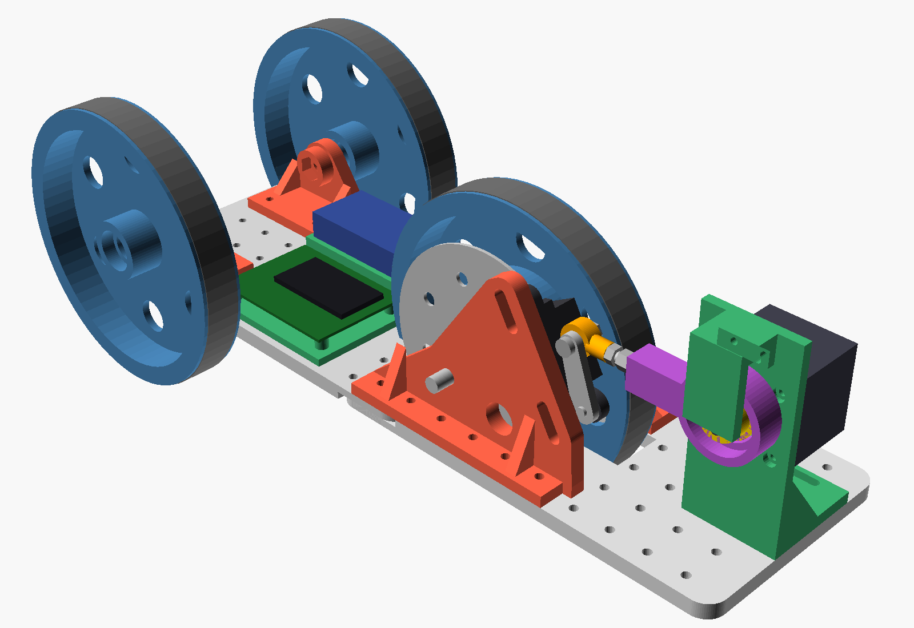
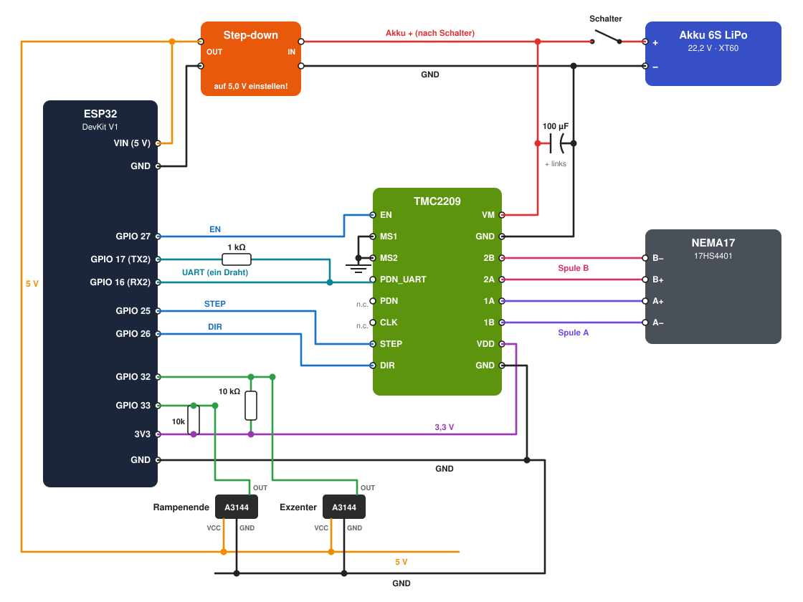

# Bremsdreirad – gibt es eine ideale Bremsfrequenz?

Physik-Versuch: Ein 3D-gedrucktes Dreirad rollt eine Rampe hinunter. Am Rampenende löst ein Hallsensor einen
**gepulsten Bremsvorgang** am Hinterrad aus (bis 20 Hz). Gemessen wird der Bremsweg in Abhängigkeit von der Bremsfrequenz.

Die Bremse: Ein NEMA17 dreht einen Exzenter, der über ein Pleuel mit Federhülse, eine M5-Gewindestange und einen
Gelenkkopf den Hebel eines Scooter-Scheibenbremssattels (110 mm Scheibe) zieht – pro Umdrehung einmal bremsen, einmal lösen.
Die Räder (150 mm) haben ein flaches Felgenbett, auf das ein Streifen Fahrradschlauch geklebt wird.

## Inhalt

| Ordner | Was |
|---|---|
| `src/`, `platformio.ini` | Firmware für ESP32 + TMC2209 (PlatformIO), mit WLAN-Bedienung |
| `hardware/cad/` | Parametrisches OpenSCAD-Modell (`bremsdreirad.scad`) |
| `hardware/stl/` | Alle Druckteile als STL |
| `hardware/step/` | Gesamte Baugruppe als STEP für Fusion 360 (gezippt) |
| `hardware/README.md` | Druckhinweise, Kaufteile, Parameter zum Anpassen |
| `docs/verkabelung.svg` / `.html` | Verdrahtungsschema mit Verbindungslisten |
| `docs/materialliste.csv` | Materialliste mit geschätzten Preisen |

## Verkabelung

Alle Verbindungen als Liste: [`docs/verkabelung.html`](docs/verkabelung.html) (herunterladen und im Browser öffnen).

**Wichtig:**
- Step-down **vorher allein** auf 5,0 V einstellen.
- UART: GPIO 17 **über 1 kΩ** und GPIO 16 direkt an PDN_UART.
- Hallsensoren A3144 an **5 V** (brauchen ≥ 4,5 V), Ausgänge mit 10 kΩ nach **3V3**.
- 100 µF Elko direkt an VM/GND des TMC2209.
- Motor **nie** ab- oder anstecken, solange der Akku dran ist.

## Firmware

In VS Code mit der PlatformIO-Erweiterung öffnen → **Upload** → **Serial Monitor** (115200 Baud).

Es gibt zwei Programme – unten in der PlatformIO-Statusleiste die Umgebung wählen:

| Umgebung | Datei | Wofür |
|---|---|---|
| `env:motortest` | `src/motortest.cpp` | **Zuerst:** nur Motor über WLAN testen, keine Hallsensoren nötig |
| `env:esp32dev` | `src/main.cpp` | Eigentlicher Versuch mit Hallsensoren, Bremslauf und Log |

### Motortest (ohne Sensoren)
WLAN `Bremsdreirad` / `physik123`, dann **http://192.168.4.1**:
- Dauerlauf starten, Frequenz per Schieberegler (auch während der Fahrt), sanft anhalten, NOT-STOP
- ¼ / 1 Umdrehung vor/zurück, Richtung wechseln, Motor bestromt/stromlos
- Motorstrom, SpreadCycle/StealthChop umschalten
- Treiberstatus: UART-Verbindung, Temperatur, Kurzschluss, offene Spule
- **Drehzahltest:** fährt 2 → 20 Hz in 2-Hz-Stufen (je 2 s) – hören, ab wann der Motor stottert

Empfehlung für den ersten Start: 800 mA, 2 Hz, Hochlauf 50 Hz/s. Kühlkörper auf den TMC2209!

### WLAN
Der ESP32 öffnet ein eigenes WLAN – kein Router nötig:
- **Name:** `Bremsdreirad` · **Passwort:** `physik123` (oben in `src/main.cpp` änderbar)
- Verbinden, dann im Browser **http://192.168.4.1** öffnen (Meldung „kein Internet“ ignorieren)
- Live: gemessene Drehzahl am Exzenter, Zustand beider Hallsensoren, Treiberstatus
- Knöpfe: STOP, Bremse öffnen, Referenzfahrt, Testlauf, Scharf (Rampe), Feinjustage, „als offen speichern“
- Letzter Bremslauf als Diagramm, Tabelle und CSV-Download

### Erste Inbetriebnahme (auf dem Tisch, Bremse zunächst ausgehängt)
1. Status prüfen → „UART: OK“.
2. Strom auf 800 mA stellen.
3. **Referenzfahrt** → Exzenter dreht langsam bis zum Magneten.
4. Mit ±10 / ±50 den Exzenter in „Bremse ganz offen“ drehen → **als offen speichern**.
5. Frequenz 5 Hz → **Testlauf** → Log ansehen.
6. Frequenz schrittweise bis 20 Hz erhöhen. Rote Zeilen im Log = Schrittverlust.
7. Bremse einhängen, 5–6 wiederholen; Strom bei Bedarf bis 1400 mA (Kühlkörper!).

### Messung
**Scharf (Rampe)** → Dreirad auf die Rampe; der Magnet am Rampenende startet den Bremslauf.
Nach jedem Lauf fährt der Exzenter automatisch neu in die Referenz und auf „offen“.

Alle Befehle gehen auch über den Seriellen Monitor (`help`). Einstellungen bleiben nach dem Ausschalten erhalten.
